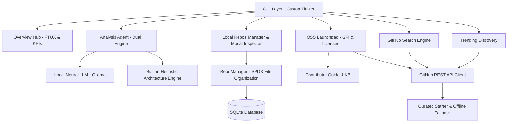

# 📖 Technical Documentation: OpenSource Repo Grabber (OSRG)

This document provides a comprehensive technical overview of the OpenSource Repo Grabber (OSRG) architecture, component hierarchy, and multi-persona execution paths.

---

## 🏗️ Architecture Overview

---

## 🧩 Module Breakdown

### 1. `run.py`
The lightweight launcher script. Adds the project root to `sys.path` and initializes the CustomTkinter event loop.

### 2. `gui.py` (`RepoGrabberApp`)
The primary desktop application controller.
- **Overview Hub**: Renders dynamic metric cards (cloned count, license folders, API status, AI engine status), persona workflow guides, quick-action shortcuts, and 1-click curated starter repos.
- **Repositories View**: Supports license filtering (`MIT`, `Apache-2.0`, `BSD`, `GPL`, etc.), local keyword search, and per-repo action controls:
  - `📖 Readme`: Modal viewer with formatted markdown text.
  - `🌳 Files`: Modal directory tree explorer with file counts and disk size metrics.
  - `🏛️ Audit`: Triggers Project Oracle or the Heuristic Architecture Engine.
  - `💻 Editor`: Smart launcher for Cursor, VS Code, Windsurf, or Explorer.
  - `🔄 Sync`: Pulls latest changes from GitHub.
  - `✕ Delete`: Removes repo from local storage.
- **OSS Launchpad & Contributor Suite**:
  - `🌟 Good First Issues Finder`: Queries GitHub for beginner-friendly tasks across programming languages.
  - `📜 License Decoder`: Interactive knowledge base detailing permissions, patent grants, and copyleft obligations.
  - `🚀 First PR & Git Guide`: Walkthrough of the 5-phase contribution lifecycle and essential Git commands.
- **AI View**: Dual-engine interface with prompt starters for architecture reviews, security audits, and beginner explanations.

### 3. `ollama_client.py` (`OllamaClient`)
Dual-engine artificial intelligence client:
- **Neural Engine**: Connects to local Ollama endpoints (`/api/generate`) with tiered exponential backoff retries.
- **Heuristic Architecture Engine**: Automatically fallback-activated when Ollama is offline or not installed. Analyzes directory topologies and anchor files (`package.json`, `pyproject.toml`, `requirements.txt`, `docker-compose.yml`, `Dockerfile`) to identify patterns (MVC, Layered, Microservice, CLI, Monorepo), detect tech stacks, calculate modularity scores, and recommend strategic roadmaps.

### 4. `github_api.py` (`GitHubClient`)
A resilient interface to GitHub REST API:
- Monitored rate limiting with exponential backoff.
- `search_good_first_issues()` for beginner-friendly contributor projects.
- `CURATED_STARTER_REPOS`: High-signal offline seeds preventing blank-state failures during rate limit depletion.
- `LICENSE_KNOWLEDGE_BASE`: Educational license metadata dictionary.

### 5. `repo_manager.py` (`RepoManager`)
Organizes cloned repositories into categorized license folders (`data/repos/<License>/<owner_name>`).
- `get_repo_file_tree()`: Scans project directory structure excluding ignored directories.
- `get_repo_stats()`: Computes total file counts and disk footprint.
- `open_in_editor()`: Detects available editors (`cursor`, `code`, `windsurf`) in system PATH with Explorer fallback.

### 6. `contributor_guide.py`
Educational knowledge base containing:
- `FIRST_PR_WORKFLOW`: 5-step lifecycle (Discovery, Environment, Branching, Commits, Pull Request).
- `GIT_ESSENTIALS`: Core Git commands and descriptions.
- `CONVENTIONAL_COMMITS`: Semantic commit type reference (`feat`, `fix`, `docs`, `refactor`, `test`, `chore`).

### 7. `database.py` (`Database`)
SQLite persistence layer storing repository metadata, releases, commits, contributors, architectural audits, and smart tags. Features automatic schema migrations.

---

## 🧪 Verification & Quality Assurance

The codebase includes comprehensive test suites:
- `tests_oracle.py`: Validates context mining and database migrations.
- `tests_ollama.py`: Validates retry logic under server and connection failures.
- `tests_enhancements.py`: Validates heuristic audits, license knowledge base, good first issues search, and repository tree calculations.
