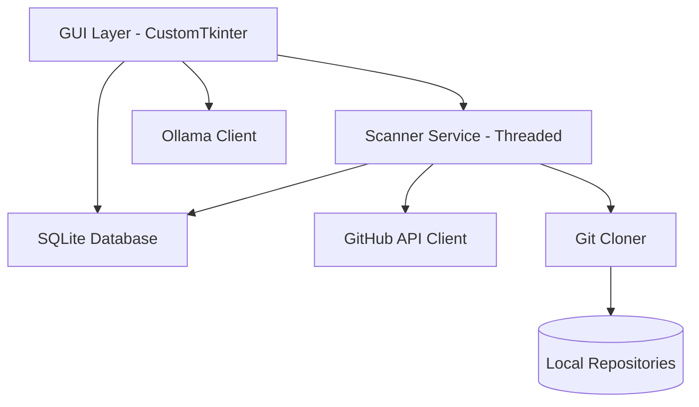

# 📖 Technical Documentation: OpenSource Repo Grabber

This document provides a detailed technical overview of the OpenSource Repo Grabber (OSRG) architecture, module structure, and data flow.

## 🏗️ Architecture Overview

The application follows a modular architecture with a separation of concerns between the UI, background processing, and data persistence.

## 🧩 Module Breakdown

### 1. `run.py`
The entry point of the application. It initializes the environment and launches the main GUI loop.

### 2. `gui.py`
Contains the `RepoGrabberApp` class, which manages the entire user interface.
-   **Structure:** Uses a sidebar for navigation and a main content area that switches between views (Dashboard, Trending, Search, AI).
-   **Threading:** Uses Python's `threading` module to run heavy operations (like cloning or AI generation) without freezing the UI.

### 3. `scanner.py`
The core background service.
-   **Class:** `ScannerService`
-   **Functionality:** Handles the scheduling and execution of repository scans. It fetches data from `GitHubClient` and persists it using `Database`.
-   **Enrichment:** Beyond basic GitHub API data, it clones repositories to extract full READMEs and release histories.

### 4. `github_api.py`
A robust wrapper around the GitHub REST API.
-   **Class:** `GitHubClient`
-   **Key Features:**
    -   Handles rate limit monitoring.
    -   Fetches all-time top and trending repositories.
    -   Retrieves contributors, commits, and releases.

### 5. `database.py`
Manages all SQLite database operations.
-   **Class:** `Database`
-   **Schema:** Stores repositories, releases, commits, contributors, and application settings.
-   **Pattern:** Uses a singleton pattern to ensure a single database connection.

### 6. `ollama_client.py`
Integrates with the local Ollama API for generative AI features.
-   **Class:** `OllamaClient`
-   **Capabilities:** Code explanation, project summarization, and contextual chat based on repository data.

### 7. `git_cloner.py`
Handles local git operations.
-   **Functionality:** Clones repositories to a local `data/repos` directory and extracts file contents for analysis.

## 🔄 Data Flow

1.  **Discovery:** `ScannerService` calls `GitHubClient` to find repositories based on license and star criteria.
2.  **Ingestion:** Basic metadata is saved to the SQLite database.
3.  **Enrichment:** The scanner clones the repository and fetches additional details (commits, contributors) from the API.
4.  **Presentation:** The GUI queries the database to display project cards and details.
5.  **AI Analysis:** When requested, the GUI sends code snippets or README content to `OllamaClient`, which communicates with the local Ollama server.

## ⚙️ Configuration (`config.py`)

The application is highly configurable via `config.py`:
-   `GITHUB_TOKEN`: Your Personal Access Token.
-   `SCAN_INTERVAL`: Default background scan frequency.
-   `DATA_DIR`: Root directory for database and cloned repos.
-   `LICENSES`: List of allowed license identifiers.

## 🛠️ Troubleshooting

-   **Rate Limiting:** If you encounter GitHub 403 errors, ensure a valid `GITHUB_TOKEN` is set.
-   **Ollama Connection:** Verify Ollama is running (`ollama serve`) and the `OLLAMA_BASE_URL` in `config.py` matches your setup.
-   **Database Issues:** If data becomes corrupted, you can safely delete the `data/osrg.db` file; the scanner will rebuild it on next launch.
